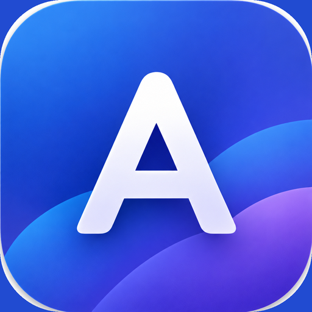

# Atlas — Personal Knowledge Manager



**Atlas v0.5.1 · Beta**  
**A Persian (Farsi), right-to-left, card-based personal project journal and knowledge manager.**

Atlas is a Progressive Web App (PWA) designed to help you keep different kinds of personal work in one calm, organized place. It is intended for individuals rather than teams: website development, app projects, buying and selling, research, writing a novel, and everything in between.

**Bring your own Dexie Cloud database.** Atlas does not provide a shared database. When you first open the app, you enter the email and Dexie Cloud database URL that **you** created. The connection information is stored on that device in IndexedDB. The app uses Dexie Cloud for email one-time-password (OTP) sign-in and synchronization across your devices. You do **not** need an `atlas.config.json` file, a Flask server, or a private backend for the web UI.

> **Language:** The application interface is currently in **Persian (Farsi)** and uses an RTL layout. This README is in English so anyone can set up the app. An English UI translation is not included.
>
> **Release status:** Beta. Back up important information and test your own hosting, security settings, and sync behavior before relying on the app for critical records.

## 1. Why Atlas exists

Atlas began with a paper notebook. Each page represented one project. Within that page were tasks to complete, tasks already finished, progress notes, lessons learned, and decisions made on particular dates. Conventional project management platforms can feel too heavy when you simply want to remember **what happened, what matters now, and what to do next**.

Atlas turns that approach into a digital, searchable project notebook:

- **One project = one notebook.**
- **One card = one task, note, checklist, decision, or progress entry.**
- **Dates matter.** You can record when something happened independently of when you typed it.
- **Priorities stay visible.** Mark multiple cards as main tasks; they appear on the dashboard.
- **Personal knowledge should remain yours.** Each installation connects to a Dexie Cloud database owned by its user, rather than a database controlled by the website publisher.

Atlas favors quick capture, chronological context, and a minimalist user interface over boards, organization charts, complex workflows, and team permissions.

## 2. Features

### Dashboard

- Counts for projects in the **Active**, **Rest**, **Suspended**, and **Completed** states.
- Instant title search for your projects.
- Main tasks from all projects; multiple main tasks per project are supported.
- Recent activity and links back into the corresponding projects.

### Projects

Create, search, filter, edit, archive, restore, and delete projects. Each project has a title, description, user-defined category, and status. Archiving is separate from status, so a completed project can also be archived. Open a project to see its own feed of cards, with newer entries first and pinned cards emphasized.

### Five kinds of cards

| Card | What it is for |
| --- | --- |
| **Task** | Action items with a status, priority, optional due date/time, pinning, and an optional **main task** flag. |
| **Progress log** | Dated progress notes with a percentage and an illustrative progress bar. |
| **Note** | Research, experience, discoveries, reference material, and freeform Markdown. |
| **Checklist** | Individual items added, edited, ticked off, or removed one by one. They are not stored as Markdown checkboxes. |
| **Decision** | Important decisions and the reasoning behind them. |

Card types have distinct visual accents. Search inside a project covers card titles and content, including checklist item text. Card creation/update timestamps are distinct from the event date, so you can write a retrospective log without losing its true date.

### Markdown support

Task, note, decision, and progress-log bodies support Markdown rendered with `react-markdown` and `remark-gfm`: headings, bold and italic, links, lists, tables, and more. Raw HTML execution is not enabled. Checklist cards use a dedicated interactive checklist editor instead of Markdown syntax.

### Planner and tasks

View tasks across different projects, track status and deadlines, and mark one or more tasks as main tasks to keep them visible on the dashboard.

### Prompt manager

Store AI prompts with a title, short description, full prompt body, user-defined tags, optional project association, favorites, search, tag filtering, and one-click copy.

### Inbox (اینباکس)

Capture an idea or reminder before deciding where it belongs. Later, associate it with a project or turn it into a project card.

### Settings, personalization, and backups

- User-defined **project types**, such as “Novel Writing” or “E-commerce”. A type in use by a project cannot be deleted until it is no longer referenced.
- Light mode with a warm cream background and a matching dark mode.
- Responsive layout for phones, tablets, and desktop browsers, with mobile navigation and safe-area handling.
- Persian typography using the bundled **AradVF** font. **Check the font’s redistribution license before redistributing this asset.** If you do not have the right to distribute it, replace it with a properly licensed font.
- Export and import JSON backups of your data; project-level Markdown export.
- Connection information and the running app version displayed in Settings.

### Apple Calendar and Reminders (iPhone and Mac)

For dated tasks, the app can open **Apple Shortcuts** using a `shortcuts://run-shortcut` deep link to invoke shortcuts named `Atlas Calendar` and `Atlas Reminder`. They can receive task details and create an item in the default destination, provided **you set up the shortcuts and permissions on your Apple devices**. This is **not** direct EventKit access or two-way Calendar/Reminders synchronization. The web app cannot reliably verify that an item was created. See [`APPLE_DEEPLINK_SETUP.md`](./APPLE_DEEPLINK_SETUP.md) for instructions.

### PWA, local caching, and sync

Atlas can be installed as a PWA. The local database uses IndexedDB and synchronization uses Dexie Cloud. Cached assets and locally stored data can support use during temporary disconnections, while sync resumes when connectivity and the relevant permissions are available. **You still need your own Dexie Cloud database to initialize the app; this release does not offer a separate account-free setup mode.** Clearing browser/site data can remove local copies of data and saved connection settings.

## 3. Architecture and ownership

| Layer | Technology |
| --- | --- |
| UI | React, TypeScript, Vite |
| Local persistence | Dexie.js / IndexedDB |
| Authentication and synchronization | Dexie Cloud |
| PWA / service worker | vite-plugin-pwa |
| Markdown rendering | react-markdown + remark-gfm |
| Deployment | Static-hosting-compatible build (for example Cloudflare) |

**Atlas is a frontend app; the code is shared, not the database.** Every user creates their own Dexie Cloud database and uses its URL and email when starting Atlas. The website owner does not host or pay for other users’ databases.

The database URL and email are **not secrets**. They are saved in a separate, device-local IndexedDB store and are not committed into your repository. Actual protection of data depends on **Dexie Cloud authentication and server-side access controls**. A frontend email check alone is not an access-control policy. A database owner should review who can register and use that database and should never expose administrative credentials.

## 4. Prerequisites

- A current supported version of **Node.js** with `npm` (use a Node.js version supported by the Vite version in `package.json`).
- Git to clone the source, or a ZIP download of the repository.
- An email inbox you can access for Dexie Cloud OTP.
- A personal **Dexie Cloud database**, created by you.
- A modern browser for development; Safari on iPhone/macOS for the target Apple PWA experience.
- For internet publishing, an HTTPS-capable static host (the maintainer uses Cloudflare Workers with static assets).

## 5. Clone and run locally

```bash
git clone https://github.com/farahzadieng/Atlas.git
cd Atlas
npm install
npm run dev
```

Open the local URL printed by Vite, typically `http://localhost:5173`. The first-run setup screen will ask for your **email** and your **Dexie Cloud database URL**. You do not create or commit any `atlas.config.json` file.

If you want to use Dexie Cloud with local development, whitelist the **exact origin** shown by the development server. The port matters.

## 6. Create your own Dexie Cloud database

From a terminal, with Node.js installed:

```bash
npx dexie-cloud create
```

Follow the CLI prompts, enter your email, and verify the OTP you receive. Note the resulting URL, such as `https://your-id.dexie.cloud`.

The Dexie Cloud CLI may create **`dexie-cloud.json`** and **`dexie-cloud.key`** in your working directory. **Do not commit either file.** The key contains privileged CLI credentials. The project’s `.gitignore` excludes them; still verify with `git status` before pushing.

Read the official [Dexie Cloud CLI documentation](https://dexie.org/docs/cloud/cli) for commands and account-specific behavior. Cloud plans may have usage limits or charges; check current pricing yourself.

## 7. Allow your app origin in Dexie Cloud

Your Dexie Cloud database will need to allow the site where Atlas runs. From a directory where the CLI can find your database credentials, run:

```bash
npx dexie-cloud whitelist http://localhost:5173
npx dexie-cloud whitelist https://YOUR-ATLAS-SITE.example
npx dexie-cloud whitelist
```

Replace both origins with the actual addresses you use. An origin includes its protocol, host, and any non-default port; do not include an arbitrary page path. The CLI's `whitelist` command can list registered origins and add new ones. **A whitelist is not a substitute for correct authorization rules.**

If you use the maintainer-hosted Atlas site instead of deploying your own copy, you must whitelist **that site’s origin** on **your** Dexie Cloud database. This does not connect you to the maintainer's database.

## 8. First-run setup and sign-in

1. Open your running Atlas instance.
2. Enter your own **email** and your own `https://...dexie.cloud` URL.
3. Save the connection. Atlas stores the settings locally in IndexedDB and reloads to initialize the correct Dexie Cloud instance.
4. Use **Send login code** to request an email OTP. Complete the Dexie Cloud login flow.
5. Create a test project and card. Open the same Atlas origin on another device, enter the same connection information once, authenticate if necessary, and confirm that your data syncs.

Each browser origin/device stores its own connection information and login state. You may need to repeat the initial setup for each new device, newly installed PWA, or new domain. The app keeps the settings until the browser/site data is deleted or becomes unavailable; session lifetime is controlled by Dexie Cloud.

To change databases later, open Settings, use the **Change connection** action, and follow the backup warning. Switching databases does not migrate your data to the new database.

## 9. Build and test

```bash
npm ci
npm run format:check
npm run lint
npm run typecheck
npm test
npm run build
npm run preview
```

Use `npm run format` to format the application components and test files. See [AGENTS.md](./AGENTS.md) for the feature map, data contracts, and UI conventions.

The build output is the `dist/` directory. You should see the app HTML, JavaScript, CSS, generated PWA manifest, service worker, font, and icon assets in the build output. The deploy command and asset-directory configuration depend on your hosting provider.

**Important:** Neither `atlas.config.json` nor a configuration-generation build script is required. The normal build command is `npm run build`.

## 10. Publish on Cloudflare

The app is a Vite-built static PWA. Deploy `dist/` using a Cloudflare setup that serves static assets over HTTPS. There are multiple Cloudflare product flows; do not confuse an Edge Function JavaScript uploader with a static-asset deployment.

A common approach is to connect your GitHub repository to a Cloudflare project and enable deploys on pushes. Ensure the deployment uses:

| Setting | Value |
| --- | --- |
| Source branch | Your chosen production branch, often `main` |
| Build command | `npm run build` |
| Output directory / static assets | `dist` |
| Node environment | A Node.js release supported by this project's Vite version |

If using **Workers Builds**, also configure the appropriate **Deploy command** / static asset settings for that product; setting only the build command does not automatically guarantee static files are published. If using **Pages**, configure its output directory `dist`. Refer to the [Cloudflare static assets documentation](https://developers.cloudflare.com/workers/static-assets/) and [Workers Builds settings](https://developers.cloudflare.com/workers/ci-cd/builds/configuration/) for your chosen flow. Preserve any already working deployment settings when updating an existing installation.

The build copies `public/_headers` to `dist/_headers`. Cloudflare applies these rules to static asset responses. The policy allows HTTPS and WebSocket connections to each user’s Dexie Cloud database. If you use a Worker or Pages Function that generates its own response, verify the headers on that response separately.

Once the site is published, add its exact HTTPS origin to **your Dexie Cloud whitelist**, then open it and complete first-run setup.

## 11. Install the PWA

**iPhone (Safari):** Open the HTTPS site in Safari, use Share → **Add to Home Screen**, and enable “Open as Web App” if that option appears. The installation uses the bundled Atlas icon. Sign in and verify that cards sync.

**macOS (Safari):** Open the site in Safari and use **File → Add to Dock** where supported. The installed app has its own window and uses the same web backend as the browser tab.

For the Shortcuts-based Apple integrations, set up the shortcuts on the corresponding device and grant requested Calendar/Reminders access. They do not install automatically with the PWA.

## 12. Update Atlas

For a deployment connected to GitHub, publish updates by committing and pushing to the connected branch:

```bash
npm run build
git status
git add .
git commit -m "Update Atlas"
git push origin main
```

Wait for the host to report a successful deployment. Because Atlas uses a service worker, an installed PWA may continue to show a cached version temporarily. Reopen the app or refresh when online, then visit **Settings → About Atlas** to see the **version currently running** (for this release, **v0.5.1 · Beta**). That label is not a live GitHub release lookup. Do not delete the PWA or clear site data just to force an update without checking your sync and backups first.

If you are using a GitHub fork, upstream changes do not appear automatically unless you sync the fork or configure an update workflow. Users of the same deployed site receive updated app assets when the deployment and PWA update complete.

## 13. Backups, safety, and troubleshooting

**Backups:** Export JSON regularly, especially before replacing devices, switching connections, or making larger changes. Sync protects against some device failures but is not a complete backup strategy. Test that your exports can be imported.

**No OTP arrives:** Check spam, the email entered in Atlas, and that the database URL belongs to your account. Check Dexie Cloud status and authorization behavior.

**App asks for first-run setup again:** Verify you are using the same browser origin and that browser/site data was not cleared; device-local connection settings are stored in IndexedDB. Private browsing or privacy-cleaning tools may prevent persistence.

**Login succeeds but your data is missing:** Confirm you entered the same database URL and account as on your other device, and verify sync completed. Different databases intentionally have separate data.

**CORS / origin error:** Whitelist the exact site origin in your own Dexie Cloud instance.

**Build fails:** Run `npm install`, confirm Node.js compatibility, and inspect the full output of `npm run build`. If TypeScript reports `__ATLAS_VERSION__`, ensure the declaration in `src/vite-env.d.ts` and the `define` value in `vite.config.ts` are both present.

**iPhone keyboard zooms the page:** Input controls use at least a 16px font on iOS. Avoid modifying the responsive CSS to set editable fields below 16px.

**PWA still shows an old version:** Check successful deployment, then reload/reopen online. The Settings version indicates the currently loaded build.

**Privacy and security:** Do not push Dexie administrative keys, emails containing OTPs, backups, or secrets to public repositories. Atlas's local configuration contains an email and a database URL, not an administrative token. The application's visible URL and frontend assets are not an access-control boundary. The database owner must configure appropriate authorization on Dexie Cloud.

## 14. Repository and contributions

The UI is Farsi-first; issues, documentation, and contributions can be written in English. If you publish your own changes, avoid putting personal database URLs or administrative credentials into commits. The app icon is located under `public/` and the installed PWA manifest is generated from `vite.config.ts`.

**Licensing:** Confirm the repository's actual license and the licenses of bundled assets before distributing the project. In particular, do not assume the included AradVF font can be redistributed without permission. A public GitHub repository does not, by itself, grant an open-source license.
